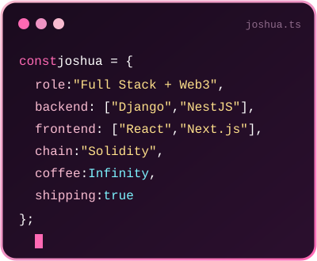

  <picture>
    <source media="(prefers-color-scheme: dark)" srcset="art/header-dark.svg">
    
  </picture>

 

<h1 align="center">Hey there, I'm Joshua 👋</h1>

  

  
  &nbsp;
  
  &nbsp;
  

 

<h2 align="center">🌸 About Me</h2>

<table>
  <tr>
    <td width="65%" valign="middle">

 

I'm a **Full Stack & Blockchain Engineer** who loves turning ideas into fast, reliable products, from clean REST APIs to smooth frontends and smart contracts.

- 💳 Currently building **crypto wallet payments at checkout** at **Stablezact**
- 🧱 Backend with **Python/Django**, **Node.js**, **Express** & **NestJS**
- 🎨 Frontend with **React** & **Next.js** in **TypeScript**
- ⛓️ Writing **Solidity** and shipping **Web3** integrations
- 🗄️ Data with **PostgreSQL** & **Redis**
- 🎓 B.Eng. **Mechanical Engineering**, University of Benin
- ⚡ Fun fact: when I'm not coding, I'm writing fiction

 

</td>
<td width="35%" align="center" valign="middle">
      
    </td>
  </tr>
</table>

 

<h2 align="center">🛠️ Tech Stack</h2>

  
    
  

 

<h2 align="center">📊 GitHub Stats</h2>

  

  

 

<!-- Snake is generated by .github/workflows/snake.yml (Platane/snk) every 12 hours into the "output" branch. -->
<h2 align="center">🐍 Contribution Snake</h2>

  <picture>
    <source media="(prefers-color-scheme: dark)" srcset="https://raw.githubusercontent.com/crazyfox19/crazyfox19/output/github-snake-dark.svg">
    <source media="(prefers-color-scheme: light)" srcset="https://raw.githubusercontent.com/crazyfox19/crazyfox19/output/github-snake.svg">
    
  </picture>

 

<h2 align="center">💌 Let's Connect</h2>

  
  &nbsp;
  
  &nbsp;
  
  <!--
  Add more by replacing the handle and moving the badge above this comment:
  
  
  
  
  -->

  ✨ Thanks for stopping by, have a lovely day! ✨

